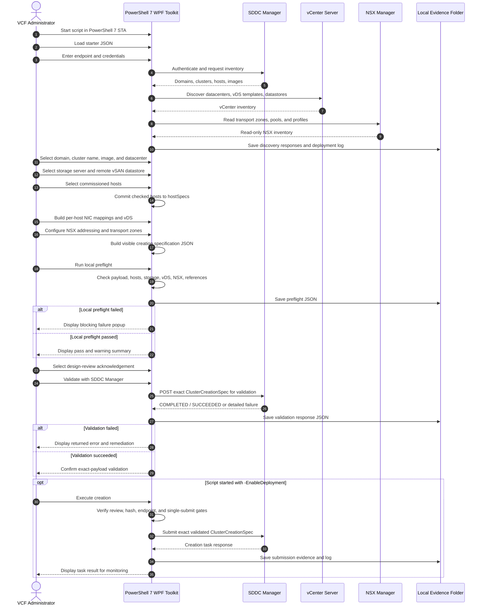

# VCF 9.1 Single-Site Compute Cluster Deployment Toolkit

A PowerShell 7 WPF toolkit for building, locally checking, validating, and optionally submitting a VCF 9.1 single-site compute-cluster creation specification.

The workflow creates a **new, non-stretched compute cluster** and mounts an existing standard or stretched remote vSAN datastore. Discovery and configuration actions build JSON only. Cluster creation remains disabled unless the script is deliberately launched with `-EnableDeployment`.

## Release files

- `VCF91-SingleSiteCompute-Deployment-v3.5.9-complete.ps1`
- `VCF91-SingleSiteCompute-Starter.json`
- `README.md`
- `WIKI.md`
- `VCF91-SingleSiteCompute-Workflow-v3.5.9.png`

## Workflow overview


## Architecture and wire flow



## Requirements

- Windows administrative workstation with WPF support
- PowerShell 7 or later in STA mode
- HTTPS connectivity to SDDC Manager, vCenter Server, and NSX Manager
- VCF 9.1 environment access
- Permissions for inventory discovery, validation, and cluster creation as applicable
- Commissioned, unassigned hosts suitable for the target domain
- Existing remote vSAN datastore presented by the selected storage cluster

## Quick start

### Planning and validation mode

```powershell
pwsh -NoProfile -STA `
  -File .\VCF91-SingleSiteCompute-Deployment-v3.5.9-complete.ps1
```

1. Load `VCF91-SingleSiteCompute-Starter.json`.
2. Connect and discover inventory.
3. Complete **General / Image**.
4. Complete **Storage / Topology**.
5. Check the intended hosts.
6. Build and apply per-host NIC and vDS mappings.
7. Apply the NSX network profile.
8. Generate JSON and run local preflight.
9. Select the design-review acknowledgement.
10. Validate with SDDC Manager.

### Execution-enabled mode

Close the validation-only session and relaunch deliberately:

```powershell
pwsh -NoProfile -STA `
  -File .\VCF91-SingleSiteCompute-Deployment-v3.5.9-complete.ps1 `
  -EnableDeployment
```

Reload the saved creation JSON, reconnect, rerun local preflight, select the review acknowledgement, and rerun SDDC validation. Execution is offered only when the current editor contents match the successfully validated payload.

## Guided configuration stages

1. **Connections / Inventory**: authenticate and perform read-only discovery.
2. **General / Image**: select target domain, cluster name, ESXi image, and datacenter.
3. **Storage / Topology**: select the storage cluster and remote vSAN datastore; set topology where applicable.
4. **Host Selection**: explicitly check commissioned hosts.
5. **Distributed Switch**: map physical NICs to uplinks and define Management, vMotion, and vSAN portgroups.
6. **NSX Network Profile**: apply transport zones and TEP addressing using None, DHCP, or a new static pool.
7. **Creation specification**: review the exact JSON submitted to validation and creation.
8. **Generate / Preflight / Validate / Execute**: create evidence, validate the exact payload, and optionally submit.

## Safety model

- Discovery is read-only.
- Form Apply actions update the local creation JSON only.
- Generate and local preflight perform no infrastructure mutation.
- SDDC validation does not create the cluster.
- Deployment is disabled unless `-EnableDeployment` is supplied at launch.
- The operator must select the design-review acknowledgement.
- Execution is bound to the exact validated editor-content hash.
- Any JSON change invalidates prior validation.
- Submission is guarded against repeated execution in the same session.

## Outputs and evidence

A timestamped run folder contains applicable files such as:

```text
VCF91-SingleSiteCompute-<timestamp>\
├── ClusterCreationSpec-<timestamp>.json
├── preflight-<timestamp>.json
├── validation-<timestamp>.json
├── inventory-Domains-<timestamp>.json
├── inventory-Clusters-<timestamp>.json
├── inventory-Hosts-<timestamp>.json
├── inventory-Images-<timestamp>.json
├── discovered-datastores-<timestamp>.json
├── nsx-transport-zones-<timestamp>.json
├── nsx-pools-<timestamp>.json
├── nsx-host-switch-profiles-raw-<timestamp>.json
├── nsx-uplink-profiles-<timestamp>.json
└── deployment.log
```

## Operational notes

- `deployWithoutLicenseKeys` is a root-level Boolean in the creation specification.
- TEP **None** uses `overlayVtepSpec.vtepType = NO_IP` and omits TEP profiles, pools, and uplink definitions.
- Per-traffic MTU values are planning information; the vDS MTU is the applied switch value.
- SDDC Manager validation remains authoritative for host eligibility, minimum host count, network compatibility, storage compatibility, and installed-version schema behavior.

## Troubleshooting summary

- **Hosts checked but NIC mappings unavailable**: click **Build per-host NIC dropdowns**. The current workflow commits explicitly checked rows to `hostSpecs`, verifies the count, and then builds selectors from discovered `physicalNics.deviceName` values.
- **Local preflight fails**: review the saved preflight JSON and the popup. Resolve every `FAIL`; warnings do not authorize execution.
- **SDDC validation succeeds but Execute remains disabled**: relaunch with `-EnableDeployment`, reload the saved JSON, reconnect, acknowledge the review, and validate the exact payload again.
- **Configuration changed after validation**: rerun local preflight and SDDC validation.
- **No NSX host-switch or uplink profiles returned**: preserve the raw responses and use only a supported addressing path that validates successfully in the installed VCF version.

## Release notes

### v3.5.9 complete

- Added visible success popups for local preflight and SDDC validation.
- Preserved detailed failure and remediation output.
- Removed file-based NSX profile and pool import paths.
- Retained automatic checked-host commit and per-host NIC selector construction.
- Retained null-safe work-in-progress JSON loading.
- Retained TEP None validation and root license-less deployment flag handling.
- Retained exact-payload validation and execution safety gates.

